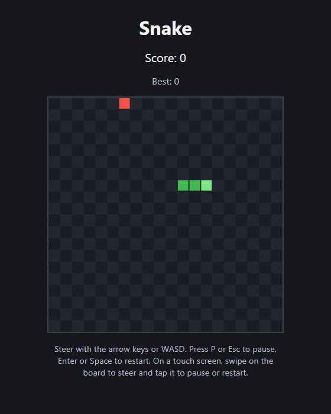

# Snake

A small Snake game for the browser, drawn on an HTML canvas and written in TypeScript with Vite.

**Play it here:** https://wjohansson94.github.io/snake-ts/



## Controls

- Arrow keys or WASD: steer
- P or Esc: pause and resume
- Enter or Space: restart after game over or a win
- Touch screens: swipe on the board to steer, tap it to pause or restart

## Features

- Food, growth, score and a high score saved in the browser (`localStorage`)
- Wall and self collisions, a game over screen and a "You win!" state when the board is full
- Pause, which also kicks in when the browser tab is hidden
- A small turn queue, so two quick key presses are not lost
- Responsive canvas, score and status announced to screen readers

## About this project

This is a hobby project where I am learning TypeScript. I am a beginner and I have worked with an AI assistant (GitHub Copilot) the whole way: it explained each step, and I typed most of the code myself and tested it as I went.

Not everything was typed by hand. The later polish step (pause, high score, turn queue, touch controls, PR #9), the GitHub Pages setup and this README were written by Copilot at my request. I tested and reviewed them, but I did not type them myself.

## Project structure

- `src/game.ts`: the game rules as plain functions (`step`, `turn`, `togglePause`), with no browser code
- `src/game.test.ts`, `src/high-score.test.ts`: unit tests (Vitest)
- `src/high-score.ts`: loading and saving the high score, checking what is read back
- `src/main.ts`: drawing, keyboard and touch input, and the game loop
- `.github/workflows/`: CI (tests and build) and the GitHub Pages deployment

## Run it locally

You need Node.js and npm.

```
npm install
npm run dev
```

Other scripts:

```
npm test          # run the unit tests
npm run build     # type-check and build to dist/
npm run preview   # serve the built version
```

## What I have learned so far

- Keeping the game rules in pure functions that return a new state, which makes them easy to test
- Writing a failing test first and then the code that makes it pass
- TypeScript types such as unions (`'playing' | 'paused' | 'gameOver' | 'won'`) and `null` checks
- Working with branches and pull requests, with CI that runs the tests and build before merging
- Not trusting stored data: the high score is checked before it is used
